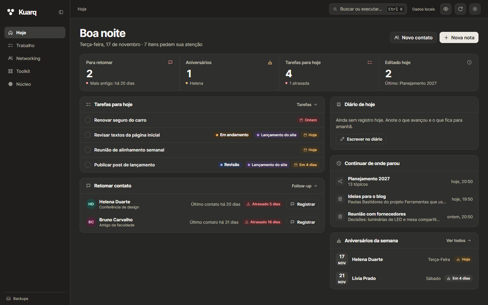
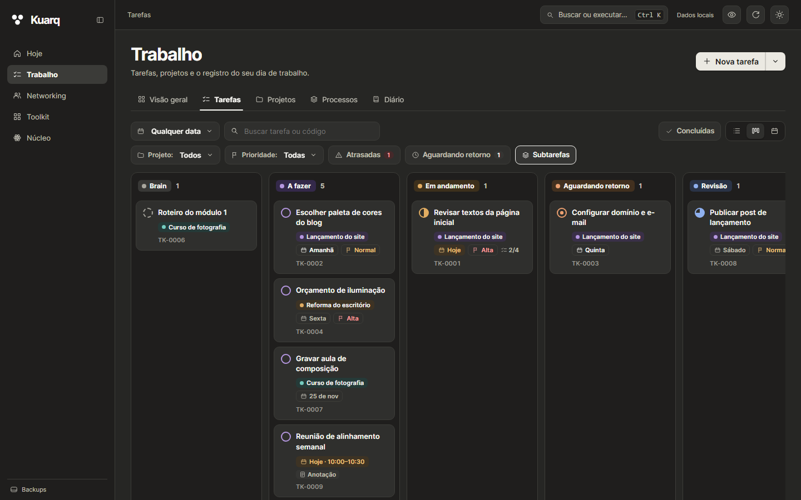
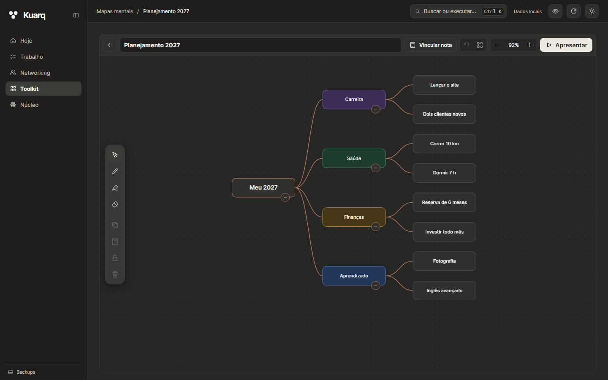
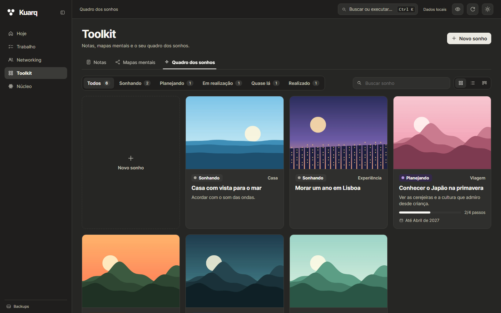
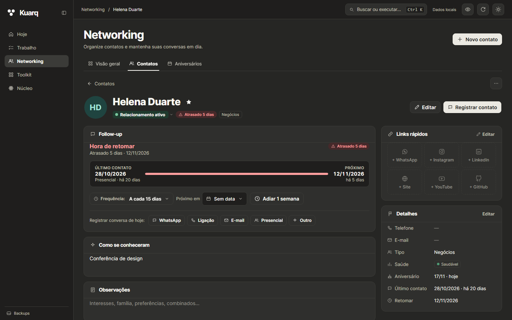

<div align="center">

<picture>
  <source media="(prefers-color-scheme: dark)" srcset="web/kuarq-logo-dark.svg" />
  <source media="(prefers-color-scheme: light)" srcset="web/kuarq-logo-light.svg" />
  
</picture>

# Kuarq

**Seu sistema pessoal, inteiro no seu computador.**

Tarefas, projetos, networking, notas, mapas mentais, finanças e quadro dos sonhos<br />
em um só app para Windows: rápido, offline e sem conta, nuvem ou assinatura.


[Instalar](#instalar) · [Módulos](#módulos) · [Privacidade](#privacidade-e-dados) · [Compilar](#compilar-a-partir-do-código) · [Documentação](#documentação) · [Contribuir](#contribuir)

<br />

<picture>
  <source media="(prefers-color-scheme: light)" srcset="docs/assets/screenshots/today-light.png" />
  
</picture>

</div>

---

## Por que o Kuarq

A maioria dos apps de produtividade guarda sua vida no servidor de alguém. O Kuarq faz o contrário: **tudo fica em um arquivo no seu PC**, com backup diário automático. Abre na hora, funciona sem internet e não coleta nada.

- **Um lugar só**: o que você faria em quatro ou cinco apps diferentes, conectado entre si. Uma tarefa abre a nota da reunião, um contato mostra os projetos dele, e o diário junta o que aconteceu no dia.
- **Feito para o dia a dia**: a tela **Hoje** mostra o que pede atenção, e a busca **Ctrl+K** encontra e executa tudo pelo teclado.
- **Seu de verdade**: os dados ficam em JSON legível, com backups compactados em `Documentos`. Sem conta e sem trava.

## Módulos

| Hoje | Trabalho | Networking |
| --- | --- | --- |
| Tarefas do dia, contatos para retomar, aniversários, contas a vencer, diário e o que você editou por último. | **Tarefas** em lista, Kanban e calendário, com subtarefas, checklist e códigos `TK-0001`. **Projetos** com etapas, marcos e metas, além de **Processos** e **Diário**. | Contatos em lista ou Kanban, favoritos, follow-up por contato com frequência própria, histórico de conversas, links rápidos e calendário de aniversários. |

| Toolkit | Núcleo |
| --- | --- |
| **Notas** com editor rico, modelos e links. **Mapas mentais** com ramos, setas, desenho livre e cards com imagem. **Quadro dos sonhos** em galeria, lista e Kanban. | Finanças pessoais: contas, cartões e faturas, investimentos, transações, contas a pagar e compras em Kanban. O **modo discreto** esconde valores para gravar a tela. |

<table>
  <tr>
    <td width="50%"></td>
    <td width="50%"></td>
  </tr>
  <tr>
    <td></td>
    <td></td>
  </tr>
</table>

O guia completo de cada tela está em [docs/MODULOS.md](docs/MODULOS.md).

## Instalar

1. Baixe o `Kuarq-vX.Y.Z-win-x64.zip` na página de [Releases](../../releases/latest).
2. Extraia em uma pasta sua (por exemplo, `C:\Apps\Kuarq`).
3. Abra o `Kuarq.exe`.

O Kuarq começa **vazio**, pronto para os seus dados. O pacote é autocontido: não precisa instalar o .NET. A interface usa o **Microsoft Edge WebView2 Runtime**, que já vem no Windows 11 e na maioria dos Windows 10 atualizados. Se faltar, baixe-o gratuitamente da Microsoft.

> O executável não é assinado digitalmente, então o Windows SmartScreen pode avisar na primeira execução. Clique em **Mais informações → Executar assim mesmo**. Se preferir, [compile você mesmo](#compilar-a-partir-do-código).

Para atualizar, feche o Kuarq e substitua os arquivos da pasta pela versão nova. Seus dados ficam em outro lugar e não são afetados.

## Privacidade e dados

| O quê | Onde |
| --- | --- |
| Dados (um arquivo JSON) | `%LOCALAPPDATA%\Kuarq\mapas.json` e a versão anterior em `mapas.json.bak` |
| Backups diários (últimos 30 dias) | `Documentos\Kuarq - Backups\kuarq-AAAA-MM-DD.json.gz` |
| Backups manuais e de segurança | Mesma pasta. Crie e restaure pelo botão **Backups** no rodapé do menu |

- **Sem rede**: a interface roda em um host virtual local (`toolkit.localhost`), e a política de segurança (CSP) bloqueia qualquer servidor externo. Não há telemetria, contas nem sincronização.
- **Imagens** (fotos de contatos, logos, sonhos e cards de mapas) são reduzidas e guardadas dentro do próprio arquivo de dados, então entram nos backups.
- **Para usar outra pasta de dados**, defina a variável de ambiente `KUARQ_DATA_DIRECTORY` com um caminho completo.

Detalhes em [docs/DADOS-E-BACKUP.md](docs/DADOS-E-BACKUP.md).

## Atalhos

| Atalho | Ação |
| --- | --- |
| `Ctrl + K` | Busca e comandos. Prefixos: `>` ações, `@` contatos, `#` tarefas (ou o código, como `tk-12`), `/` notas |
| `F5` | Recarregar a interface (salva antes) |
| `Ctrl + Z` | Desfazer no mapa mental |
| `V` `P` `M` `E` | Mapa: selecionar, caneta, marcador e borracha |
| `Enter` / `F2` · `Insert` | Mapa: editar o card · criar um card filho |
| `Ctrl + C` `V` `D` | Mapa: copiar, colar e duplicar um ramo |
| `Ctrl + V` com imagem | Coloca a imagem no card do mapa ou no sonho aberto |
| `Esc` | Fechar painéis e sair da apresentação |

## Compilar a partir do código

Requisitos: Windows 10 ou 11 x64, [.NET SDK 10](https://dotnet.microsoft.com/download) e [Node.js 20+](https://nodejs.org) (só para as verificações).

```powershell
git clone https://github.com/rafaeltrismegistus/kuarq.git
cd kuarq
.\scripts\build.ps1          # verifica e compila em desktop\app
.\scripts\build.ps1 -Zip     # também gera o pacote em dist\
```

Depois abra `desktop\app\Kuarq.exe` ou o atalho `Abrir Kuarq.cmd`. A interface (HTML, CSS e JavaScript sem build) fica em `web/` e é copiada na compilação. Durante o desenvolvimento, editar `desktop\app\web` e apertar `F5` mostra a mudança na hora. Lembre de levar a alteração para `web/`.

```text
kuarq/
├─ desktop/            App nativo (WPF + WebView2): janela, arquivo de dados, backups
├─ web/                Interface: um módulo JavaScript por área, sem dependências
├─ scripts/            build.ps1 (compilar e empacotar) e check.mjs (verificações)
├─ docs/               Guia dos módulos, arquitetura, dados e capturas
└─ .github/            Modelos de issue e PR e Dependabot
```

## Documentação

- [Guia dos módulos](docs/MODULOS.md): como usar cada tela.
- [Arquitetura](docs/ARQUITETURA.md): como o app nativo e a interface conversam e como criar um módulo.
- [Dados e backup](docs/DADOS-E-BACKUP.md): formato, limites, restauração e migração.
- [Diretrizes de engenharia](.ai/README.md): contexto, estado atual, mapa do código e regras para quem desenvolve.
- [Changelog](CHANGELOG.md) · [Segurança](SECURITY.md) · [Contribuir](CONTRIBUTING.md)

## Contribuir

Contribuições são bem-vindas. Leia o [CONTRIBUTING](CONTRIBUTING.md): ele explica o fluxo de branch e PR, as verificações e os princípios de interface (controles com o visual do Kuarq, nada de rede, dados antigos sempre abrindo). Encontrou um problema? Abra uma [issue](../../issues/new/choose) sem anexar dados pessoais.

## Licença

[MIT](LICENSE) © Rafael Trismegisto
